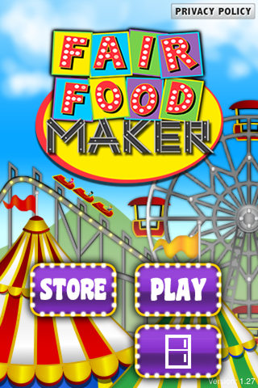
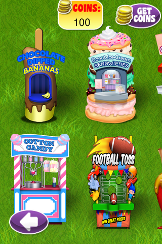
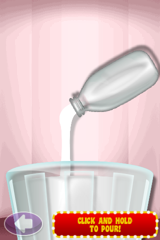
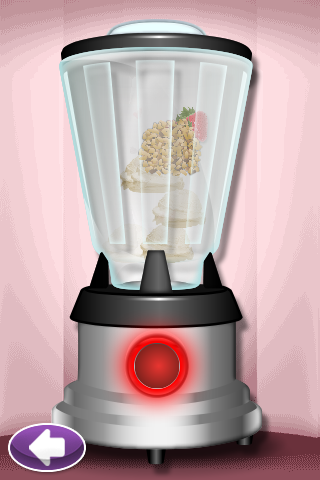
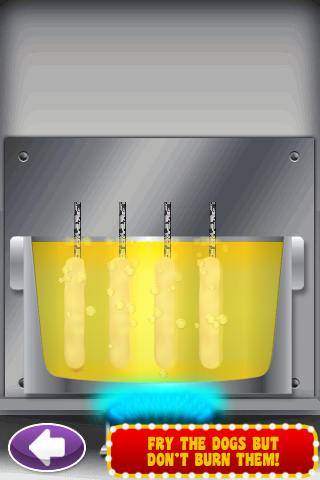
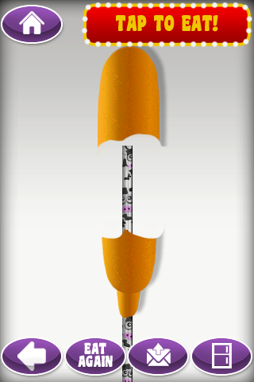
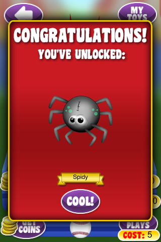
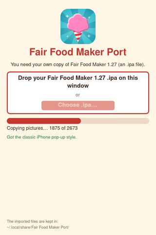

# Fair Food Maker Port

Play Sunstorm's **Fair Food Maker** (the iPhone game, version 1.27) on Windows, Mac and
Linux. Make corn dogs, cotton candy, milkshakes and more, then win prizes at the midway
games. Everything is unlocked, with no ads and nothing to buy.

| | |
|---|---|
|  |  |
|  |  |
|  |  |
|  |  |

## What you need

Your own copy of Fair Food Maker 1.27 (an .ipa file). Other versions won't work.

## How to play

1. Download the zip for your computer from the Releases page and unzip it.
2. Open the game.
3. Drag your copy of Fair Food Maker 1.27 (an .ipa file) onto the window, or click
   **Choose .ipa...** to find it.
4. Wait a few seconds while it sets up. Next time it opens straight to the menu.

Your computer may warn you the first time, because the game isn't signed:

- **Windows:** click **More info**, then **Run anyway**.
- **Mac:** if it won't open, go to **System Settings > Privacy & Security** and click
  **Open Anyway**.

## Controls

Click to tap, drag to swipe, and click and hold where the phone asked you to tilt it.

## Saves

Your progress saves by itself. To start over, delete this folder:

- Windows: `%APPDATA%\Fair Food Maker Port`
- Mac: `~/Library/Application Support/Fair Food Maker Port`
- Linux: `~/.local/share/Fair Food Maker Port`

## Legal

This is a fan project to keep the game playable. It is not affiliated with or endorsed by
Sunstorm Interactive, TabTale, or anyone else connected to Fair Food Maker, which belongs
to its owners. The screenshots show the original game's art as this port displays it.
The iPhone pop-up style is Apple's; the game downloads it from the Internet Archive and
it is not included here.

The code here is free software under the GNU GPL, version 3 or later (see
[LICENSE](LICENSE)). That license covers this project's code only, not the game.
